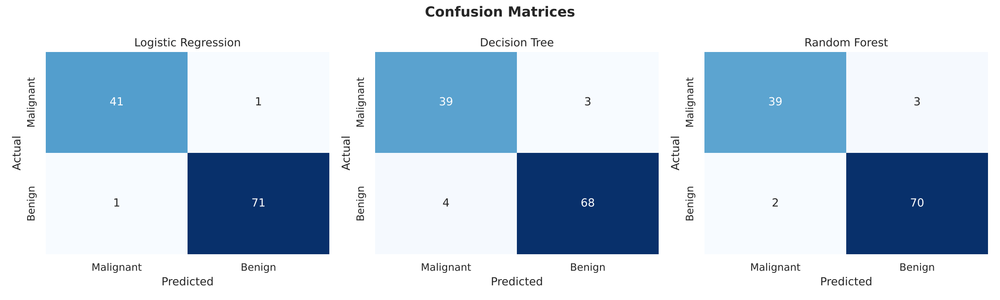

# Predictive Modeling Using Machine Learning

Supervised learning project: train, test and evaluate multiple models for **classification** and **regression** using scikit-learn.



## Part A - Classification: Breast Cancer Diagnosis
**Goal:** predict whether a tumour is malignant or benign from 30 cell-nucleus measurements (569 samples, built into scikit-learn).

**Method:** 80/20 stratified train-test split, 5-fold cross-validation, three algorithms.

| Model | CV Acc. | Test Acc. | Precision | Recall | F1 | ROC-AUC |
|---|---|---|---|---|---|---|
| **Logistic Regression** | 0.980 | **0.983** | 0.986 | 0.986 | 0.986 | **0.995** |
| Decision Tree | 0.939 | 0.939 | 0.958 | 0.944 | 0.951 | 0.934 |
| Random Forest | 0.960 | 0.956 | 0.959 | 0.972 | 0.966 | 0.993 |

Evaluation visuals: confusion matrices, ROC curves, model comparison, feature importance (see `outputs/`).

**Findings**
- Logistic Regression is best, with only 2 mistakes out of 114 test samples.
- The most important features are `worst perimeter`, `worst area` and `worst concave points`.
- A shallow Decision Tree is the weakest and the least stable of the three.

## Part B - Regression: Diabetes Progression
**Goal:** predict a numeric disease-progression score from 10 baseline health features (442 samples).

| Model | MAE | RMSE | R2 |
|---|---|---|---|
| Linear Regression | 42.8 | 53.9 | 0.453 |
| Decision Tree | 47.0 | 59.7 | 0.326 |
| Random Forest | 43.6 | 53.8 | 0.453 |

Linear Regression matches Random Forest, which suggests the relationship is largely linear and the dataset is small and noisy.

## Project Structure
```
├── data/        breast_cancer.csv
├── src/         train_models.py
├── outputs/     charts, results CSVs, model_report.txt
├── requirements.txt
└── README.md
```

## How to Run
```bash
pip install -r requirements.txt
python src/train_models.py
```

## Tech Stack
Python, scikit-learn, Pandas, NumPy, Matplotlib, Seaborn

## What I Learned
Supervised learning, train/test splitting, cross-validation, and model evaluation with confusion matrices, ROC curves, precision/recall and R2.
